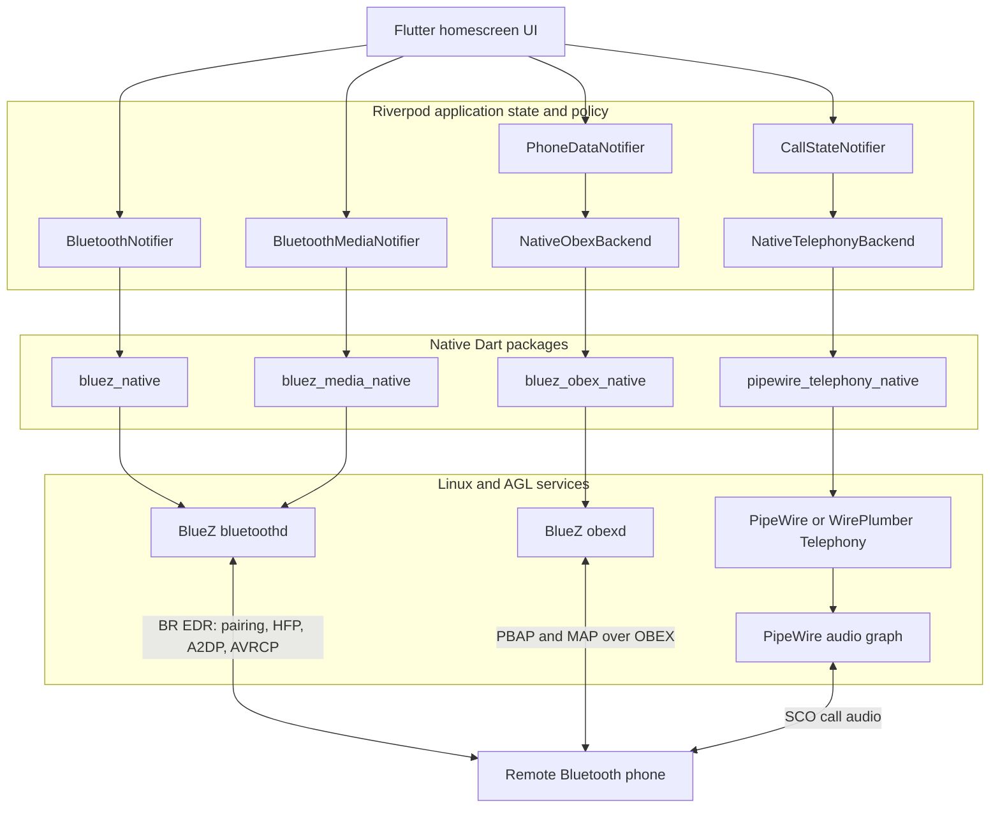

# GSoC 2026 Final Report: AGL Bluetooth Integration

## Project details

| Field | Details |
| --- | --- |
| Contributor | JianDe (Jaydon) |
| Organization | Automotive Grade Linux (AGL) |
| Primary mentor | George Kiagiadakis, Collabora |
| Secondary mentor | Joel Winarske, Toyota Connected North America |
| Backup mentors | Justin Noel, Integrated Computer Solutions; Walt Miner, Linux Foundation |
| GSoC project | [AGL Bluetooth Integration](https://summerofcode.withgoogle.com/programs/2026/projects/jkzcDIbh) |
| Final report permalink | [`agl-bluetooth-integration-gsoc26/README.md`](https://github.com/jaydon2020/agl-bluetooth-integration-gsoc26/blob/main/README.md) |
| Project documentation | [`agl-bluetooth-integration-gsoc26`](https://jaydon2020.github.io/agl-bluetooth-integration-gsoc26/) |

This README is the stable final-work submission. The Gerrit changes, Jira
tickets, implementation snapshot, native-library repositories, and supporting
documentation below identify the work completed during GSoC 2026.

## Project overview

This project brings native Bluetooth phone integration to Automotive Grade
Linux's Flutter Instrument Cluster and Infotainment homescreen. It replaces
demo-only Bluetooth behavior with an integration that uses BlueZ, BlueZ OBEX,
PipeWire Telephony, WirePlumber, and MPD while keeping the Flutter application
responsible for presentation and state coordination.

The completed work lets a driver discover and pair a phone, play and control
Bluetooth media, synchronize contacts and call history, manage hands-free
calls, and recover cleanly when a phone or system service disconnects. The
native D-Bus library supports MAP, providing the foundation for the pending
homescreen messaging integration.

## Goals and outcomes

| Goal | Outcome | Status |
| --- | --- | --- |
| Build a phone-pairing settings flow | Added adapter power, discovery, pairing prompts, trust, connection policy, supported-profile filtering, and device lifecycle handling through `bluez_native`. | Completed |
| Add A2DP and AVRCP media support | Added player discovery, metadata, playback controls, repeat/shuffle, browsing, cover art, and media source coordination through `bluez_media_native`. | Completed |
| Create reusable native Bluetooth libraries | Integrated native Dart packages for BlueZ device management, media, OBEX, and PipeWire Telephony with clear lifecycle and ownership boundaries. | Completed |
| Add PBAP phone-book support | Added contact and recent-call synchronization, vCard parsing, revision-aware refresh, per-device persistence, and caller-name resolution. | Completed stretch goal |
| Add HFP telephony support | Added gateway selection, call state and controls, DTMF, gain/mute controls, and SCO transport activation. | Completed stretch goal |
| Add MAP messaging support | `bluez_obex_native` supports MAP sessions and D-Bus operations; homescreen messaging integration remains to be completed. | Pending |
| Deliver an automotive phone UI | Added Dial, Contacts, Recents, incoming-call, active-call, keypad, call-waiting, and multiparty interfaces. | Completed |
| Make the integration resilient | Added per-device isolation, stale-result protection, serialized profile work, retry handling, atomic cache writes, and service recovery. | Completed |

## Current state and upstream status

| Area | Current state | Public work reference |
| --- | --- | --- |
| Bluetooth pairing and settings | Merged upstream | [Gerrit 31887](https://gerrit.automotivelinux.org/gerrit/c/apps/flutter-ics-homescreen/+/31887) |
| A2DP and AVRCP homescreen integration | Merged upstream | [Gerrit 32060](https://gerrit.automotivelinux.org/gerrit/c/apps/flutter-ics-homescreen/+/32060) |
| Native BlueZ media library | Imported into the official AGL repository | [Gerrit 32074](https://gerrit.automotivelinux.org/gerrit/c/staging/bluez-media-native/+/32074) |
| BlueZ media-player fixes | Merged into the AGL demo layer | [Gerrit 32104](https://gerrit.automotivelinux.org/gerrit/c/AGL/meta-agl-demo/+/32104) |
| Native PipeWire HFP configuration | Open upstream change | [Gerrit 32154](https://gerrit.automotivelinux.org/gerrit/c/AGL/meta-agl/+/32154) |
| Native telephony and OBEX libraries | Development repositories available; AGL repository requests open | [SPEC-5755](https://lf-automotivelinux.atlassian.net/browse/SPEC-5755), [SPEC-5756](https://lf-automotivelinux.atlassian.net/browse/SPEC-5756) |
| MAP homescreen application | Pending; native MAP D-Bus support is available | [`bluez_obex_native`](https://github.com/jaydon2020/bluez_obex_native) |

## System architecture

The implementation separates application policy, native Dart packages, Linux
services, and the remote phone so every backend has one clear owner.

### Runtime ownership

| Layer | Owns | Does not own |
| --- | --- | --- |
| `BluetoothNotifier` | Adapter state, scan policy, pairing prompts, one-phone connection policy, trust, device blocking, and HFP profile activation | Calls, contacts, messages, media metadata, and audio graph routing |
| `BluetoothMediaNotifier` | Current media player, playback commands, metadata, cover art, browsable items, and media transport state | Device pairing or call audio |
| `PhoneDataNotifier` | Per-phone contact cache, PBAP synchronization, call-history import, and transfer completion policy | Bluetooth connection, live HFP calls, and the pending MAP application flow |
| `CallStateNotifier` | Selected gateway, call UI state, call commands, DTMF, HFP volumes, and SCO activation policy | Pairing, PBAP/MAP data, and final PipeWire node linking |

## Work completed

### 1. Bluetooth device management

The Bluetooth settings flow now manages radio power, BR/EDR discovery,
pairing prompts, trust, connection and disconnection, device removal, and a
single-active-phone policy. Supported phone profiles are detected from BlueZ
UUIDs and device class information.

External or stale connection events are checked against the active operation,
so asynchronous results cannot silently replace the selected device. Profile
activation targets the selected BlueZ object and treats an already connected
profile as success.

### 2. A2DP and AVRCP media

The media integration uses `bluez_media_native` to observe BlueZ Media1
players, folders, items, and transports. The homescreen displays track
metadata, playback state, position, and cover art and provides play, pause,
next, previous, repeat, shuffle, and browsed-item playback controls.

PipeWire and WirePlumber retain responsibility for A2DP audio routing. The
homescreen pauses Bluetooth media when switching to another audio source, which
prevents competing playback without duplicating platform audio policy in the
Flutter layer.

### 3. PBAP contacts and call history

PBAP support retrieves contacts and incoming, outgoing, and missed call
history through `bluez_obex_native`. The implementation parses vCards,
contact photos, multiple phone numbers, timestamps, and call direction into
typed Flutter models.

Contacts are stored separately for every phone. Reconnecting a phone restores
its cached contacts immediately and checks PBAP database/version counters
before downloading again. If a phone does not expose those optional counters,
the app compares the complete handle/name listing. A manual refresh covers
number-only or photo-only edits that listings cannot detect.

Cache writes are serialized and atomic. The data directory uses mode `0700`
and the cache uses mode `0600`. Failed or incomplete transfers retain the last
valid phone book instead of replacing it with partial data.

### 4. HFP calling and SCO audio

The Phone application follows the connected Bluetooth address and selects the
matching PipeWire Telephony gateway. It supports:

- dialing from the keypad, contacts, and recents;
- incoming, outgoing, dialing, alerting, waiting, active, held, ended, and
  multiparty call states;
- answer, decline, hang up, DTMF, mute/unmute, swap, end-and-swap, merge,
  hold-and-answer, and end-and-answer operations;
- caller-name and photo resolution using only the connected phone's contacts;
- microphone and speaker gain state; and
- SCO activation after an active call receives a usable transport.

Commands are serialized so rapid taps do not submit duplicate operations.
Call state is generation-scoped, preventing results from a disconnected phone
or old gateway from updating a newly selected phone. Transport, codec, and
RejectSCO fields are cleared when the backend removes them.

### 5. MAP native-library support

`bluez_obex_native` provides the native D-Bus foundation for MAP, including
MAP session creation, folder and message access, message retrieval, read and
delete state, transfer handling, and message sending. Integrating these APIs
into the homescreen Messages application remains pending.

### 6. Automotive user experience

The Flutter UI includes a Phone launcher and responsive layouts for the desktop
development viewport and automotive landscape displays. Call overlays remain
visible outside the Phone screen. Controls expose explicit disabled and error
states, use large touch targets, and show only operations valid for the current
call topology.

The dialer supports contact suggestions and preserves the selected contact name
through the outgoing-call transition. The media screen presents remote track
and playback state while coexisting with the homescreen's other audio sources.

### 7. Native build and deployment support

The project uses Dart native assets for `bluez_native`,
`bluez_media_native`, `bluez_obex_native`, and
`pipewire_telephony_native`. The documentation covers host bootstrap, native
submodules, Flutter Linux bundles, AGL cross-compilation, and the target-correct
`native_assets.json` required by Flutter 3.38 AOT builds.

The application checks the session bus before falling back to the system bus,
supporting both desktop WirePlumber services and the AGL service layout.

## Gerrit changes and Jira tickets

The following status reflects the AGL Gerrit records on 2 November 2026.
Gerrit calls code-review submissions *changes* rather than merge requests.

### Changes authored during the project

| Gerrit change | Repository | Contribution | Status | Jira |
| --- | --- | --- | --- | --- |
| [31578](https://gerrit.automotivelinux.org/gerrit/c/AGL/documentation/+/31578) | `AGL/documentation` | Correct AGL quick-start and image-building documentation | Merged | — |
| [31887](https://gerrit.automotivelinux.org/gerrit/c/apps/flutter-ics-homescreen/+/31887) | `apps/flutter-ics-homescreen` | Add the Bluetooth pairing UI and `bluez_native` support | Merged | [SPEC-5669](https://lf-automotivelinux.atlassian.net/browse/SPEC-5669) |
| [32060](https://gerrit.automotivelinux.org/gerrit/c/apps/flutter-ics-homescreen/+/32060) | `apps/flutter-ics-homescreen` | Add Bluetooth media playback support | Merged | [SPEC-5715](https://lf-automotivelinux.atlassian.net/browse/SPEC-5715) |
| [32074](https://gerrit.automotivelinux.org/gerrit/c/staging/bluez-media-native/+/32074) | `staging/bluez-media-native` | Import the reusable `bluez-media-native` library into AGL | Merged | [SPEC-5718](https://lf-automotivelinux.atlassian.net/browse/SPEC-5718) |
| [32103](https://gerrit.automotivelinux.org/gerrit/c/AGL/meta-agl-demo/+/32103) | `AGL/meta-agl-demo` | Update the homescreen recipe revision for Bluetooth media support | Abandoned | [SPEC-5715](https://lf-automotivelinux.atlassian.net/browse/SPEC-5715) |
| [32104](https://gerrit.automotivelinux.org/gerrit/c/AGL/meta-agl-demo/+/32104) | `AGL/meta-agl-demo` | Backport BlueZ 5.86 media-player fixes | Merged | [SPEC-5719](https://lf-automotivelinux.atlassian.net/browse/SPEC-5719) |
| [32154](https://gerrit.automotivelinux.org/gerrit/c/AGL/meta-agl/+/32154) | `AGL/meta-agl` | Configure PipeWire's native HFP telephony backend and D-Bus policy | Open | [SPEC-5754](https://lf-automotivelinux.atlassian.net/browse/SPEC-5754) |

### Related AGL integration changes

These changes were authored by other AGL contributors but directly supported
the project's build environment.

| Gerrit change | Repository | Relationship to this project | Status | Jira |
| --- | --- | --- | --- | --- |
| [31893](https://gerrit.automotivelinux.org/gerrit/c/AGL/AGL-repo/+/31893) | `AGL/AGL-repo` | Updated AGL to the Yocto Project 6.0.2 baseline used by this project | Merged | [SPEC-5670](https://lf-automotivelinux.atlassian.net/browse/SPEC-5670) |
| [31977](https://gerrit.automotivelinux.org/gerrit/c/AGL/meta-agl/+/31977) | `AGL/meta-agl` | Added the Flutter build class needed by applications with native plugins | Merged | [SPEC-5680](https://lf-automotivelinux.atlassian.net/browse/SPEC-5680) |
| [31989](https://gerrit.automotivelinux.org/gerrit/c/AGL/meta-agl/+/31989) | `AGL/meta-agl` | Fixed the native-plugin Flutter build class and toolchain settings | Merged | [SPEC-5680](https://lf-automotivelinux.atlassian.net/browse/SPEC-5680) |

### Jira ticket index

| Ticket | Scope |
| --- | --- |
| [SPEC-5669](https://lf-automotivelinux.atlassian.net/browse/SPEC-5669) | Bluetooth setup, connection, and pairing UI |
| [SPEC-5670](https://lf-automotivelinux.atlassian.net/browse/SPEC-5670) | Yocto Project 6.0.2 platform update used by the project |
| [SPEC-5680](https://lf-automotivelinux.atlassian.net/browse/SPEC-5680) | AGL Flutter native-plugin build support |
| [SPEC-5715](https://lf-automotivelinux.atlassian.net/browse/SPEC-5715) | Bluetooth media integration in `flutter-ics-homescreen` |
| [SPEC-5718](https://lf-automotivelinux.atlassian.net/browse/SPEC-5718) | Request to create an official AGL repository for the BlueZ media native library |
| [SPEC-5719](https://lf-automotivelinux.atlassian.net/browse/SPEC-5719) | BlueZ media-player fixes |
| [SPEC-5754](https://lf-automotivelinux.atlassian.net/browse/SPEC-5754) | Native PipeWire HFP telephony backend for AGL |
| [SPEC-5755](https://lf-automotivelinux.atlassian.net/browse/SPEC-5755) | Repository request for `pipewire_telephony_native` |
| [SPEC-5756](https://lf-automotivelinux.atlassian.net/browse/SPEC-5756) | Repository request for `bluez_obex_native` |

### `bluez_media_native` repository and issue traceability

| Artifact | Link | Outcome |
| --- | --- | --- |
| Development repository | [`jaydon2020/bluez_media_native`](https://github.com/jaydon2020/bluez_media_native) | Original development repository for the native Dart and Flutter BlueZ media bindings |
| AGL repository request | [SPEC-5718](https://lf-automotivelinux.atlassian.net/browse/SPEC-5718) | Requested a project-owned repository in AGL Gerrit |
| Official AGL repository | [`staging/bluez-media-native`](https://gerrit.automotivelinux.org/gerrit/admin/repos/staging/bluez-media-native) | Active AGL-hosted repository created from the request |
| Initial repository import | [Gerrit change 32074](https://gerrit.automotivelinux.org/gerrit/c/staging/bluez-media-native/+/32074) | Merged the initial library source into the AGL repository |
| BlueZ media-player issue | [Project issue #5](https://github.com/jaydon2020/agl-bluetooth-integration-gsoc26/issues/5) | Tracked the `bluetoothd` null-dereference when `MediaItem1.Play()` was called; closed after the fixes were incorporated |
| BlueZ fix series | [Patchwork series 1149990](https://patchwork.kernel.org/project/bluetooth/list/?series=1149990) | Fixed the crash and related pending-request and player-state defects |
| AGL BlueZ backport | [Gerrit change 32104](https://gerrit.automotivelinux.org/gerrit/c/AGL/meta-agl-demo/+/32104) | Merged the five-patch series into the AGL demo layer |

### Additional native repository requests

| Library | Development repository | AGL repository request | Status |
| --- | --- | --- | --- |
| `pipewire_telephony_native` | [`jaydon2020/pipewire_telephony_native`](https://github.com/jaydon2020/pipewire_telephony_native) | [SPEC-5755](https://lf-automotivelinux.atlassian.net/browse/SPEC-5755) | Open; AGL repository pending |
| `bluez_obex_native` | [`jaydon2020/bluez_obex_native`](https://github.com/jaydon2020/bluez_obex_native) | [SPEC-5756](https://lf-automotivelinux.atlassian.net/browse/SPEC-5756) | Open; AGL repository pending |

## Challenges and lessons learned

### Optional and inconsistent phone capabilities

PBAP version counters are optional, MAP operations vary by phone, and some
devices publish profiles only after pairing. The implementation uses capability
checks and safe fallbacks instead of assuming one vendor behavior.

### Multiple asynchronous systems

BlueZ, OBEX, PipeWire, Riverpod, and the Flutter UI all emit state
independently. Serialized lifecycle work and generation identifiers ensure
that late events cannot cross phone boundaries.

### Native asset cross-building

The native packages must be built for the AGL target and registered in the AOT
native-asset manifest. Host-built shared libraries cannot be copied into the
image. The resulting workflow and runtime paths are documented for future AGL
integrators.

### Safety-oriented call controls

The UI derives available actions from the complete call topology. It does not
show unsupported controls, and pending commands disable overlapping actions.
This keeps the interface predictable when phones expose different
call-control capabilities.

## Remaining work

MAP remains an application-level integration task. The next step is to connect
the native MAP D-Bus support to the homescreen Messages application.

## Conclusion

The project moved AGL's Flutter homescreen from a visual Bluetooth settings
demo to a native phone-integration stack with device management, A2DP/AVRCP
media, persistent contacts, call history, HFP calling, SCO audio coordination,
and native MAP D-Bus support. The homescreen MAP messaging flow remains
pending. The architecture keeps platform services behind provider and native
backend boundaries, while the documentation provides a practical base for
downstream integration and upstream review.
