# Flutter ICS Homescreen Bluetooth Implementation and Integration Specification

| Field | Value |
| --- | --- |
| Document status | Final implementation baseline |
| System of interest | `flutter-ics-homescreen` Bluetooth subsystem |
| Application revision | `f638373e6fa9ae5dd0662e642daa228d9f8a8559` |
| Reviewed workspace | Local tree at 2026-10-28, including the uncommitted HFP profile-connect change described in §2.2 |
| Target | Automotive Grade Linux (AGL), Linux, Flutter 3.38.3 / Dart 3.10.1 baseline |
| Verification | 100 Flutter tests passed on 2026-10-28 |
| Owner | Flutter ICS Homescreen maintainers |

## 1. Purpose and conformance statement

This document is the final, source-backed description of Bluetooth integration in
`flutter-ics-homescreen`. It defines the supported Bluetooth profiles, application
architecture, runtime behavior, interfaces, failure handling, privacy controls,
deployment dependencies, and verification criteria.

The document is organized as an architecture description using the concerns and
viewpoint approach of [ISO/IEC/IEEE 42010:2022](https://www.iso.org/standard/74393.html).
Requirements use the meanings of MUST, SHOULD and MAY from
[RFC 2119](https://www.rfc-editor.org/rfc/rfc2119). Cybersecurity recommendations
are aligned with the lifecycle and risk-management intent of
[ISO/SAE 21434:2021](https://www.iso.org/standard/70918.html). This structure
supports industrial review; it does **not** claim product certification or
standards conformance without the corresponding organizational process, threat
analysis, target evidence, independent review, and approval.

### 1.1 Stakeholders and concerns

| Stakeholder | Primary concern |
| --- | --- |
| Driver and passenger | Predictable pairing, media, phone, contacts and messaging behavior |
| HMI developer | Stable Riverpod state, non-blocking commands and topology-valid controls |
| Platform integrator | BlueZ, OBEX, PipeWire/WirePlumber, D-Bus policy and audio routing |
| Security/privacy reviewer | Authorization, trusted-device policy and protection of personal data |
| Test and release engineer | Reproducible dependency baseline, traceable requirements and target evidence |
| Maintainer | Clear ownership boundaries, lifecycle recovery and package compatibility |

### 1.2 Scope

In scope:

- BR/EDR adapter power, discovery, pairing, trust, connection and removal;
- single-active-phone policy and reconnection authorization;
- A2DP transport observation and AVRCP media browsing/control;
- PBAP contacts, call history and per-phone cache;
- MAP conversations, message operations and attachments;
- HFP call control and phone-originated call-state synchronization;
- SCO transport observation/activation and HFP gain control;
- Flutter/Riverpod presentation behavior and native package boundaries.

Out of scope:

- Bluetooth Low Energy/GATT product features;
- raw PCM routing, microphone/speaker selection and audio focus;
- modem/SIM telephony;
- system-wide Bluetooth policy outside this application;
- phone-side implementation quality and carrier behavior;
- claims of ISO 26262 functional-safety certification.

## 2. Configuration baseline

### 2.1 Native dependencies

| Package | Resolved baseline | Application responsibility |
| --- | --- | --- |
| `bluez_native` | `0.3.1` | BlueZ adapter/device/agent operations over the system bus |
| `bluez_media_native` | `0.3.1` | BlueZ media players, folders, items, transports and cover art |
| `bluez_obex_native` | `0.1.0`, commit `3be5f8a4638958c22dfc5a9e148ac6e68665fab9` | OBEX PBAP/MAP sessions and transfers |
| `pipewire_telephony_native` | `0.1.0`, commit `db241b1e00f1915ab1db79ec2b21a2bd9b6d71c1` | PipeWire telephony gateways, calls and SCO transports |
| `dbus` | `0.7.12` | Direct calls required by the application integration layer |

Detailed native-package design records are available in
[the native project documentation bundle](native-project-docs/README.md).

### 2.2 Reproducibility note

The application revision above is the last committed baseline. The reviewed
workspace also contained these owner changes:

- an explicit `org.bluez.Device1.ConnectProfile` call for the remote HFP Audio
  Gateway UUID after initial connection and reconnection;
- a Linux bundle/build adjustment for native assets and the PipeWire telephony
  submodule;
- a focused HFP profile-connection test;
- a native-library feature matrix workbook.

These items are documented because they materially affect the reviewed behavior,
but they MUST be committed and reviewed before a release can claim this exact
baseline. No changes were made to that application workspace by this document.

## 3. Profile and capability baseline

### 3.1 Status definitions

| Status | Meaning |
| --- | --- |
| Supported | Implemented in the app and covered by automated tests or direct source evidence |
| Conditional | Implemented, but requires a compatible phone, topology, service or target policy |
| Not release-validated | Code surface exists, but current product status does not claim support |
| External | Required for the user outcome but owned by another platform component |
| Not supported | Deliberately absent from the current product behavior |

### 3.2 Bluetooth profiles and roles

| Profile/service | Remote UUID | Phone role | AGL role | Status | User capability |
| --- | --- | --- | --- | --- | --- |
| Generic Access / BlueZ device management | n/a | Remote device | Central HMI policy client | Supported | Discover, pair, trust, connect, disconnect and remove a phone |
| A2DP Source | `0000110a-0000-1000-8000-00805f9b34fb` | Audio source | Audio sink consumer | Conditional | Receive phone media audio; PCM routing is external |
| AVRCP Remote Control | `0000110e-0000-1000-8000-00805f9b34fb` | Media target/provider | Controller/browser | Conditional | Metadata, play/pause, next/previous, shuffle, repeat and browsing |
| HFP Audio Gateway | `0000111f-0000-1000-8000-00805f9b34fb` | Audio Gateway | Hands-Free Unit/HMI | Conditional | Dial, answer, decline/end, multi-call controls, gain and call state |
| PBAP Phonebook Server Equipment | `0000112f-0000-1000-8000-00805f9b34fb` | PSE | Phonebook client | Conditional | Contacts, photos and call history |
| MAP Message Access Server | `00001132-0000-1000-8000-00805f9b34fb` | MAS | Message client | Conditional and privacy-sensitive | Conversations, send, read, delete/restore and attachments |
| SCO/eSCO transport | Negotiated by HFP stack | Audio Gateway | Hands-Free audio endpoint | Conditional | Bidirectional call audio transport |

The UUID list is both a capability filter and an authorization boundary. A device
with none of the recognized UUIDs is not accepted as a supported phone. A
smartphone-class fallback is used where service discovery is incomplete.

### 3.3 Feature summary

| ID | Feature | Status | Defined behavior |
| --- | --- | --- | --- |
| BT-01 | Adapter power | Supported | Turns the selected BlueZ adapter on or off and refreshes state |
| BT-02 | Phone discovery | Supported | Uses BR/EDR discovery and stops automatically after two minutes |
| BT-03 | Pairing agent | Supported | Displays confirmation/passkey/PIN requests and rejects unsolicited requests outside an authorized flow |
| BT-04 | Paired-device limit | Supported | Refuses an eleventh paired device until one is removed |
| BT-05 | Single active phone | Supported | Keeps one supported phone connected and disconnects/blocks competing supported phones |
| BT-06 | Trusted reconnection | Supported | Permits the sole trusted supported phone to reconnect when appropriate |
| MED-01 | Media metadata and transport | Supported | Tracks player, A2DP transport, title, artist, album, duration, position and play state |
| MED-02 | Media control | Conditional | Play/pause, next, previous, shuffle and repeat depend on the phone player |
| MED-03 | Media browsing | Conditional | Shows playable items exposed by the selected remote player |
| MED-04 | Cover art | Conditional | Uses configured native OBEX mode or an existing MPRIS/cover-art session fallback |
| PB-01 | Contacts | Conditional | Downloads PBAP contacts and photos, indexes them locally and supports search |
| PB-02 | Contact cache | Supported | Stores separate validated phonebooks per normalized Bluetooth address |
| PB-03 | Call history | Conditional | Loads combined history or falls back to incoming/outgoing/missed phonebooks |
| MAP-01 | Conversations | Conditional | Loads inbox/sent metadata, groups messages by normalized peer and fetches bodies on demand |
| MAP-02 | Message actions | Conditional | Send, mark read, delete, restore and download attachments when the phone permits them |
| TEL-01 | Basic calling | Conditional | Dial, answer, decline/end and hang up all through PipeWire telephony |
| TEL-02 | Phone-side state sync | Supported | If the phone answers, hangs up, holds or swaps calls, D-Bus events automatically update overlays, controls, participant and duration |
| TEL-03 | Waiting/multi-call | Conditional | Hold & answer, End & answer, Swap, End & swap and Merge appear only for valid call topology and phone capability |
| TEL-04 | In-call DTMF keypad | Not release-validated | UI/backend code can submit tones, but the current product baseline does not claim DTMF support |
| TEL-05 | Microphone mute | Conditional | Sets HFP microphone gain to zero and restores the prior non-zero gain |
| TEL-06 | HFP speaker gain | Conditional | Changes HFP speaker gain; it does not choose an audio output route |
| TEL-07 | SCO monitoring/activation | Conditional | Tracks transport state/codec/RejectSCO and activates usable SCO once a call is active |
| TEL-08 | Single-call hold/resume | Not supported | No standalone Hold/Resume operation is exposed; multi-call actions require the relevant topology |

## 4. Architecture viewpoints

### 4.1 System-context view

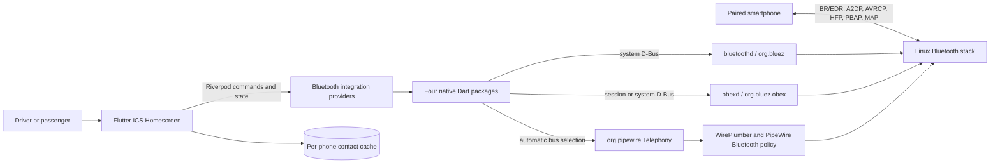

### 4.2 Logical component view

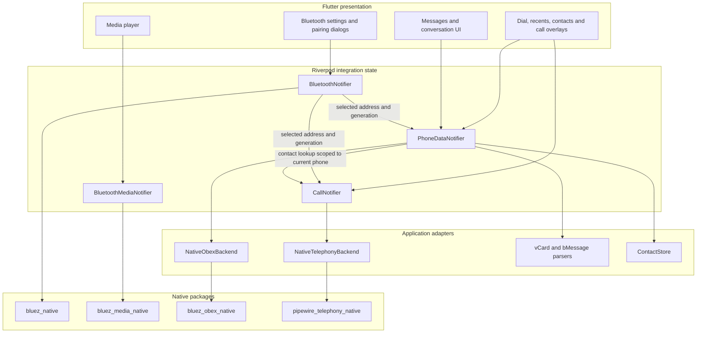

### 4.3 Native and D-Bus boundary view

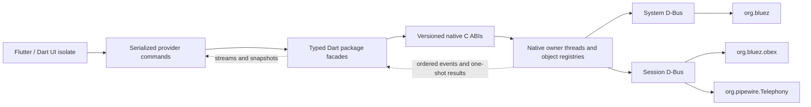

Native clients own their D-Bus connections, event loops, proxies and handle
registries. The Flutter UI MUST NOT perform a blocking D-Bus wait. Commands are
serialized at the provider boundary and state returns through streams/snapshots.

### 4.4 Deployment view

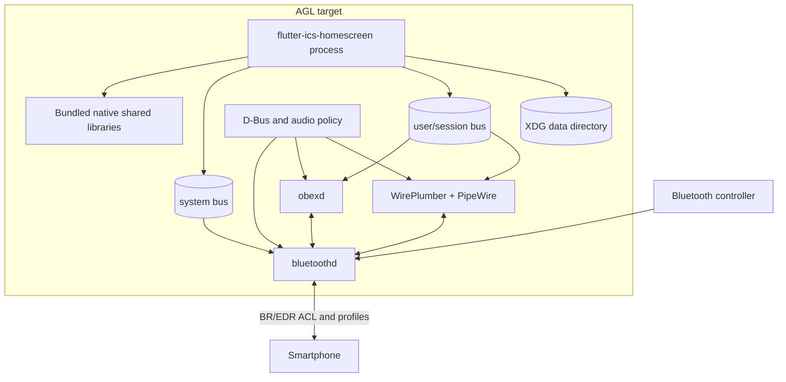

`PipeWireBus.automatic` checks the session bus first and then the system bus.
The deployment MUST grant only the D-Bus methods and properties required by the
selected integration. Raw media/call PCM, device choice and audio focus remain
WirePlumber/AGL policy responsibilities.

## 5. Common lifecycle and device policy

### 5.1 Startup

At process startup, the app explicitly starts the Bluetooth client, phone-data
provider and call-state provider. Media state is initialized when a consumer
watches it.

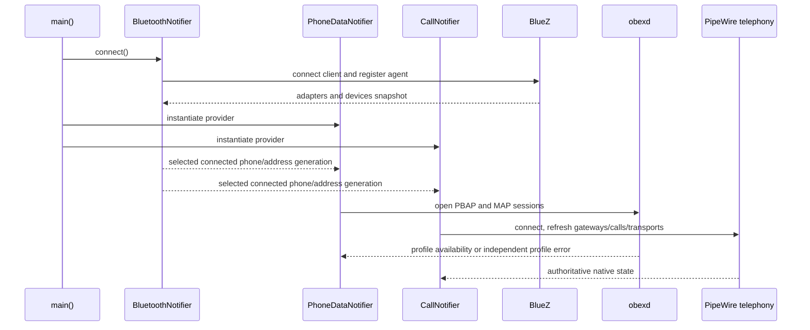

### 5.2 Discovery and pairing

1. The app MUST use BR/EDR discovery for supported phone profiles.
2. Discovery MUST stop after two minutes or when the user leaves the scan flow.
3. Unsolicited pairing requests MUST be rejected unless discovery or an explicit
   operation makes the device eligible.
4. A paired device MUST be trusted before normal connection.
5. The system MUST allow no more than ten paired devices under this app policy.
6. Only one supported phone MAY remain connected. Other supported paired phones
   are disconnected and temporarily blocked while the active phone is connected.
7. If connecting the new phone fails, the app SHOULD restore the previous phone.
8. After connection, the reviewed workspace explicitly requests the remote HFP
   Audio Gateway profile when the device advertises it. `AlreadyConnected` is
   treated as success; other errors are surfaced without discarding all device
   state.

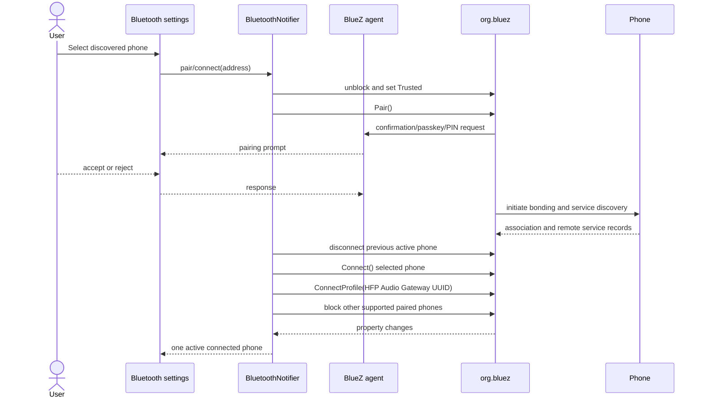

### 5.3 Device lifecycle state

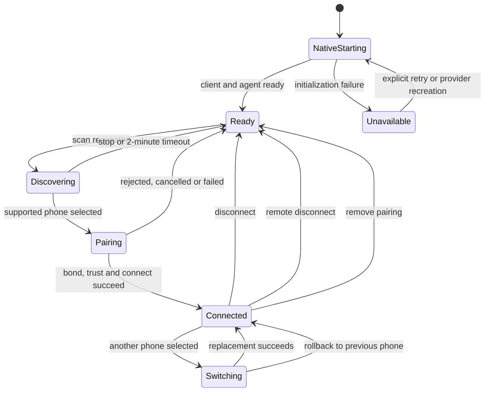

Every asynchronous phone-specific subsystem uses a monotonically changing
generation. A completion from an older phone or older native client MUST NOT
modify the current phone's state.

## 6. Media integration: A2DP and AVRCP

### 6.1 Selection and state

The media provider selects the most relevant remote player in this order:

1. a currently playing player;
2. the previously selected player if it still exists;
3. the first available player.

For that player's phone, it selects an A2DP transport in this order: active,
previously selected, then first available. An idle A2DP transport still indicates
profile connection; only an active transport indicates streaming.

The UI tracks title, artist, album, duration, playback position, play state,
shuffle, repeat, cover art, current item and browsable items. Position refreshes
once per second only while playing.

### 6.2 Commands and cover art

Commands are serialized. Play/pause may update optimistically, but the next
native snapshot reconciles the result. Duplicate or late completions cannot
override a newer generation.

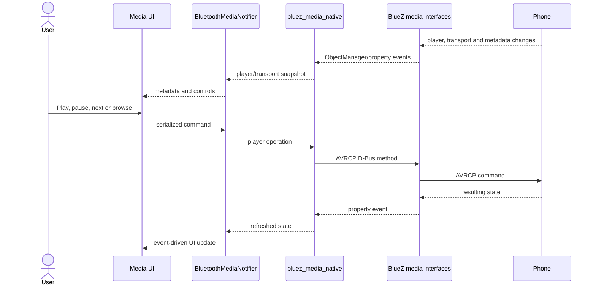

Cover-art mode is configuration-controlled:

- native mode requests art through the package and stores it in a temporary
  directory;
- MPRIS mode first attempts MPRIS retrieval, then may reuse an already existing
  compatible cover-art session;
- failures retry twice with two- and four-second delays;
- current art remains visible until a valid replacement is ready;
- temporary directories are removed during replacement/disposal.

The homescreen does not acquire or route A2DP PCM. BlueZ, PipeWire and
WirePlumber own codecs, transport acquisition and output policy.

## 7. Phone data integration: PBAP

### 7.1 Contact synchronization

PBAP and MAP sessions are created independently so one profile may remain usable
when the other is unavailable. OBEX opening has a 15-second application timeout.

The contact flow selects `int/pb`, then prefers database identifiers/version
counters. If those are unavailable, it compares phonebook size and a complete
indexed listing. A changed phonebook is downloaded as vCard 3.0 with name,
telephone, UID and photo fields.

Before replacing a saved phonebook, the app MUST validate:

- a complete vCard envelope;
- consistency with the reported phonebook size;
- successful transfer completion;
- ownership by the current phone generation.

An empty download is valid only when the phone reports a zero-size phonebook.
Failed or incomplete downloads retain the last validated cache.

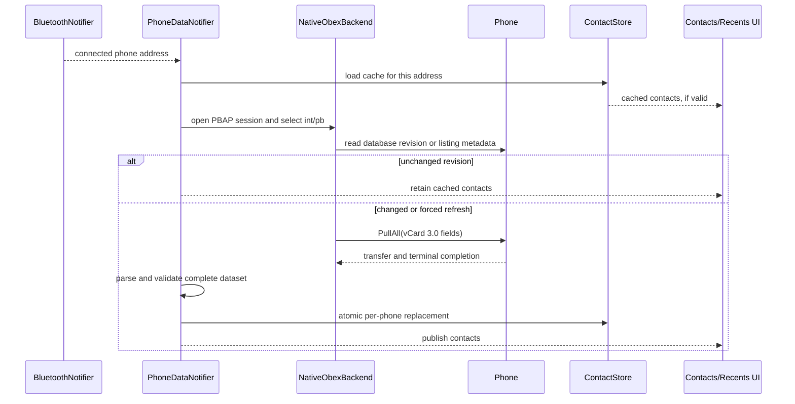

If version counters are unavailable, handle/name listing comparison cannot detect
number-only or photo-only edits. A user-triggered forced refresh is therefore
required for guaranteed refresh on such phones.

### 7.2 Cache and call history

Contacts are stored at
`$XDG_DATA_HOME/flutter-ics-homescreen/contacts.json`, or under
`$HOME/.local/share` when `XDG_DATA_HOME` is absent. The containing directory is
created with mode `0700`; a temporary file with mode `0600` is atomically renamed.
Writes are serialized and indexed by normalized Bluetooth address. No phone may
see another phone's cached contacts.

Call history first requests the combined call history (`cch`). If unsupported,
the app loads incoming (`ich`), outgoing (`och`) and missed (`mch`) histories,
then deduplicates and sorts the result.

## 8. Messaging integration: MAP

MAP is personal-data intensive. Production builds MUST expose the Messages UI
only when product privacy policy, user consent, D-Bus policy and retention rules
are approved. Documentation and screenshots MUST mask telephone numbers and
message content unless the data is explicitly synthetic.

### 8.1 Behavior

- Refresh may request `UpdateInbox`; lack of phone support does not make the
  whole profile fail.
- Inbox and sent metadata are listed and grouped into conversations using a
  normalized peer address. Alphabetic/unknown senders remain distinct.
- Existing message bodies and attachments are preserved across metadata refresh.
- Opening a conversation downloads missing bodies and may mark messages read.
- Sending creates a standards-shaped bMessage with CRLF framing and a UTF-8 byte
  `LENGTH`, then pushes it to the outbox with retry enabled.
- A send failure leaves the UI recoverable and permits retry; it must not create
  a false delivered state.
- Delete, restore, mark-read and attachment download are forwarded only for the
  current phone generation.

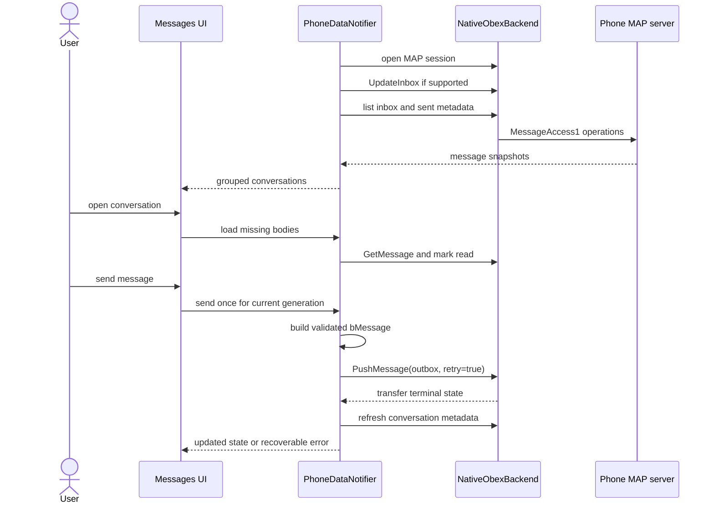

Transfer polling is bounded to 30 seconds. Removal of a transfer object is not
proof of success unless a terminal completed event was already observed.

## 9. Telephony integration: HFP and SCO

### 9.1 Gateway binding

The telephony client connects with automatic bus selection and a 12-second
startup timeout. It binds only to the gateway whose normalized Bluetooth address
matches the currently selected phone, and only accepts calls associated with
that gateway. A mismatch is reported as unavailable rather than displaying call
data from another phone.

The primary call is selected in this order: incoming, waiting, active, dialing,
alerting, then held. The displayed participant and duration reset when the
primary call identity changes. Contact names are resolved only from a cache owned
by the same current phone.

An outgoing call may start from the Dial, Recents, Contacts or message
conversation route. Each route passes the chosen number and, where known, contact
name into one serialized dial operation. The pending identity is retained until
the native call object arrives, preventing the participant label from briefly
changing or disappearing. Rapid repeated taps cannot submit a second dial while
the first command is pending.

### 9.2 Call behavior and automatic UI synchronization

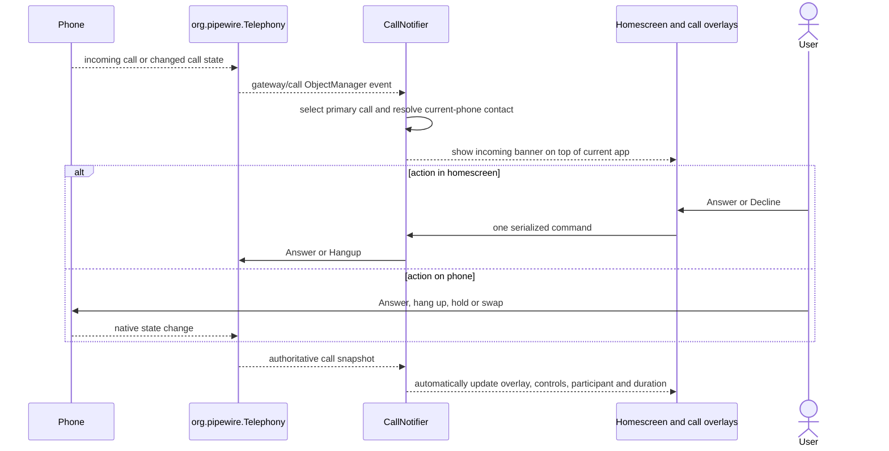

The UI does not assume that actions originate locally. When the user accepts,
hangs up, holds or swaps on the phone, native call-state events automatically
drive the same homescreen update as a local action.

### 9.3 Call-state model

```mermaid
stateDiagram-v2
    [*] --> Idle
    Idle --> Dialing: dial requested
    Idle --> Incoming: incoming call event
    Dialing --> Alerting: phone reports alerting
    Dialing --> Active: remote answers
    Alerting --> Active: remote answers
    Incoming --> Active: answered on HMI or phone
    Incoming --> Ended: declined or remote ends
    Active --> Waiting: second incoming call
    Active --> Held: phone/topology holds current call
    Waiting --> Active: hold-and-answer or end-and-answer
    Held --> Active: swap or release-and-swap
    Active --> Multiparty: merge when supported
    Held --> Multiparty: merge when supported
    Multiparty --> Active: participant/topology change
    Active --> Ended: local or phone hangup
    Held --> Ended: call released
    Ended --> Idle: no remaining calls
```

Unknown future native states are preserved as raw state while mapping the UI to a
safe known state. A single call never exposes Hold/Resume. Waiting-call actions
require active + waiting calls; Swap, End & swap and Merge require the relevant
active/held topology and phone CHLD capability.

### 9.4 Command safety and SCO

Only one mutating call command may be in flight. The selected control visibly
disables, duplicate taps are ignored, and an error unlocks controls and appears
in the UI. A late completion from a disconnected phone or replaced telephony
client cannot modify current state.

When a call becomes active, the app activates SCO only if a usable matching
transport exists, the state is neither active nor pending, and `RejectSCO` is not
true. Activation is deduplicated and retried when transport state later becomes
usable. Transport removal or Bluetooth loss clears state, codec and RejectSCO
rather than presenting stale diagnostics.

Microphone mute writes gain `0` and restores the last non-zero gain. The speaker
button modifies HFP speaker gain in the same way; it is not a speaker-routing or
audio-focus control. Both gains are constrained to `0..15`.

Although the UI and backend include `SendTones`, DTMF remains **not
release-validated** for the current product baseline. It MUST NOT be advertised
as supported until target evidence confirms exactly-once tones during an active
call on the approved phone matrix.

## 10. Resilience and error handling

| Failure | Required behavior |
| --- | --- |
| BlueZ client unavailable | Report native unavailability; do not present stale native state as live |
| Unsolicited pairing | Reject unless an explicit discovery/pairing policy authorizes the device |
| Additional phone connects | Disconnect it and preserve the single-active-phone invariant |
| Phone switches mid-operation | Increment generation, close old sessions and ignore late results |
| PBAP download incomplete | Keep last validated per-phone cache and show refresh error |
| MAP unavailable | Keep PBAP usable; expose an explicit messaging-profile unavailable state |
| PBAP unavailable | Keep MAP usable where possible; do not leak contacts from another phone |
| OBEX transfer timeout | Cancel or fail visibly; never infer success from object disappearance alone |
| Media service unavailable | Retry initialization with 2, 4, 8, 16 and 30 second backoff |
| PipeWire telephony loss | Clear native call/gateway state, report disconnection and require a fresh client/Retry |
| Command D-Bus error | Preserve recoverable UI, surface the error and unlock controls |
| SCO appears late | Wait for usable transport and submit at most one activation at a time |
| SCO is removed | Clear transport-derived diagnostics and wait for a new incarnation |

## 11. Security and privacy requirements

| ID | Requirement |
| --- | --- |
| SEC-01 | The product MUST perform a documented threat analysis and risk assessment before production release; this document is not a substitute for ISO/SAE 21434 work products. |
| SEC-02 | Pairing MUST require explicit user intent and confirmation appropriate to the phone's association model. |
| SEC-03 | The app MUST reject unsolicited authorization and pairing outside the controlled flow. |
| SEC-04 | D-Bus policy MUST apply least privilege to `org.bluez`, `org.bluez.obex` and `org.pipewire.Telephony`; the app MUST NOT run as root merely to bypass policy. |
| SEC-05 | Contacts and messages MUST be associated with the normalized current device identity and invalidated on device switch. |
| SEC-06 | Logs, screenshots, issue attachments and test evidence MUST mask telephone numbers, contact names, message bodies, Bluetooth addresses and stable identifiers unless synthetic. |
| SEC-07 | Contact-cache directory/file permissions MUST remain `0700`/`0600`, and writes MUST remain atomic. Production policy SHOULD add encryption at rest or eliminate persistent caching where required. |
| SEC-08 | Temporary vCard, bMessage, attachment and cover-art files MUST be private, bounded and removed after use or shutdown. |
| SEC-09 | Message access MUST be disabled or hidden where user consent, retention and distraction policy are not approved. |
| SEC-10 | Native shared libraries and Git dependencies MUST be pinned, reproducibly built, inventoried in an SBOM and scanned under the release process. |
| SEC-11 | Input lengths, phone numbers, paths, D-Bus variants, vCards and bMessages MUST be validated at trust boundaries. |
| SEC-12 | Driver-distraction policy MUST govern pairing, browsing, messaging and manual dialing while the vehicle is moving. |

## 12. Requirements traceability

| Requirement | Implementation evidence | Verification evidence |
| --- | --- | --- |
| BT-01..06 | `bluetooth_notifier.dart`, Bluetooth settings screens | HFP connector test plus manual pairing/device-policy tests |
| MED-01..04 | `bluetooth_media_notifier.dart`, media player/controls | `media_restore_test.dart`; target AVRCP/A2DP evidence required |
| PB-01..03 | `phone_data_notifier.dart`, `obex_backend.dart`, parsers/store | `phone_data_notifier_test.dart`, `contact_store_test.dart`, `phone_parsers_test.dart` |
| MAP-01..02 | `phone_data_notifier.dart`, MAP backend and message screens | `map_flow_test.dart`, parser/notifier tests; target privacy approval required |
| TEL-01..08 | `call_notifier.dart`, `telephony_backend.dart`, call screens/overlays | `telephony_flow_test.dart`, `calls_test.dart`, HFP connector test; hardware audio evidence required |
| SEC-01..12 | Pairing authorization, per-phone generations, file modes and release controls | Security review, TARA, penetration testing, policy review and privacy audit required |

### 12.1 Automated baseline

The following command completed successfully on 2026-10-28:

```text
flutter test --reporter compact
00:16 +100: All tests passed!
```

CI installs Linux native build prerequisites, uses Flutter 3.38.3, runs
`flutter analyze --no-fatal-infos`, and runs the Flutter test suite. Automated
tests validate state logic and UI behavior, but cannot substitute for target
Bluetooth interoperability, acoustic or privacy tests.

### 12.2 Release acceptance matrix

| ID | Target acceptance test | Expected result |
| --- | --- | --- |
| ACC-01 | Pair each approved phone from a clean AGL image | User-authorized pairing succeeds, phone is trusted, only one phone stays active and reconnect works after reboot |
| ACC-02 | Stream media and exercise every exposed control | Metadata/state follows the phone, controls are not duplicated and audio remains stable |
| ACC-03 | Sync a large phonebook, restart, edit a number/photo and force refresh | Cache is phone-scoped, startup reuses it, and forced refresh retrieves edits |
| ACC-04 | Load call histories on phones with and without combined history | Combined or fallback histories are complete, deduplicated and ordered |
| ACC-05 | Exercise approved MAP flows with synthetic accounts | No cross-phone data, exactly-once send attempt, recoverable errors and correct transfer completion |
| ACC-06 | Receive a call while viewing another app | Correct masked/synthetic contact appears in the overlay; Answer and Decline each submit one operation |
| ACC-07 | Answer and end calls from both phone and HMI | The homescreen automatically follows native state with no stale overlay |
| ACC-08 | Create waiting and held-call topologies | Only valid Hold & answer, End & answer, Swap, End & swap and Merge controls appear and update automatically after phone-side actions |
| ACC-09 | Attempt rapid repeated call commands | One native operation is submitted; controls disable until success or error |
| ACC-10 | Disconnect phone A mid-call and connect phone B | A's calls, contacts, gateway and delayed results never appear for B |
| ACC-11 | Restart BlueZ, obexd and PipeWire telephony independently | Each subsystem reports loss, clears stale state and recovers using a fresh client/session |
| ACC-12 | Validate every approved HFP codec and SCO recreation | Correct codec is reported; audio is bidirectional with no persistent echo/silence; activation is not duplicated |
| ACC-13 | Validate DTMF on the approved phone matrix | Required before TEL-04 can move from not release-validated to supported |
| ACC-14 | Inspect logs, cache, temporary files and screenshots | No unmasked personal data; permissions, cleanup and retention meet product policy |

The release record SHOULD capture AGL image revision, kernel, BlueZ, PipeWire,
WirePlumber and obexd versions; controller firmware; phone model/OS; profile and
codec capability; D-Bus policy; test operator; timestamp; and pass/fail evidence.

## 13. Build, integration and operational requirements

1. Native libraries MUST be built from their pinned sources and installed in the
   application bundle. Linux CMake must include Dart native-assets output.
2. The PipeWire telephony package's pinned sdbus-c++ submodule MUST be available
   before plugin configuration or supplied as an approved prebuilt dependency.
3. `bluetoothd`, `obexd`, WirePlumber and PipeWire MUST be enabled with compatible
   profiles and D-Bus policy on the target image.
4. The app service identity MUST have the minimum required bus access and access
   to its private XDG data directory.
5. Runtime diagnostics SHOULD report service availability, selected device
   identity in masked form, profile availability, player/gateway selection,
   transport state and codec, command error name, and current generation.
6. Diagnostics MUST NOT log message bodies, full phone numbers, contact photos,
   unmasked Bluetooth addresses, PINs or passkeys.
7. Service-owner loss is terminal for a native client instance. Recovery MUST
   construct a fresh client rather than reuse stale objects.

## 14. Known limitations and release risks

- The app supports one active phone; simultaneous multi-phone operation is not a
  product capability.
- DTMF code exists but is not currently claimed as supported.
- Single-call Hold/Resume is not supported.
- Multi-call behavior depends on phone CHLD and conference support.
- PBAP fallback metadata cannot detect number/photo-only edits without force refresh.
- MAP behavior and attachment support vary by phone and require explicit privacy approval.
- Media browsing, shuffle, repeat and cover art depend on the remote player.
- HFP gain is not equivalent to platform audio routing or focus.
- The automated suite uses fakes/mocks for native flows; real target profile,
  audio, service-restart and interoperability evidence remains mandatory.
- The explicit HFP connection and Linux bundling changes were present only in the
  reviewed working tree and must enter the controlled release history.

## 15. References

- [ISO/IEC/IEEE 42010:2022 — Architecture description](https://www.iso.org/standard/74393.html)
- [ISO/SAE 21434:2021 — Road vehicles cybersecurity engineering](https://www.iso.org/standard/70918.html)
- [RFC 2119 — Requirement-level keywords](https://www.rfc-editor.org/rfc/rfc2119)
- [BlueZ `org.bluez.Device1` API](https://github.com/bluez/bluez/blob/master/doc/org.bluez.Device.rst)
- [BlueZ adapter API](https://github.com/bluez/bluez/blob/master/doc/org.bluez.Adapter.rst)
- [BlueZ pairing agent API](https://github.com/bluez/bluez/blob/master/doc/org.bluez.Agent.rst)
- [BlueZ media APIs](https://github.com/bluez/bluez/tree/master/doc)
- [BlueZ OBEX client API](https://github.com/bluez/bluez/blob/master/doc/org.bluez.obex.Client.rst)
- [BlueZ PBAP API](https://github.com/bluez/bluez/blob/master/doc/org.bluez.obex.PhonebookAccess.rst)
- [BlueZ MAP API](https://github.com/bluez/bluez/blob/master/doc/org.bluez.obex.MessageAccess.rst)
- [PipeWire 1.6.6 telephony guide](https://github.com/PipeWire/pipewire/blob/1.6.6/spa/plugins/bluez5/README-Telephony.md)
- [Native package architecture bundle](native-project-docs/README.md)

